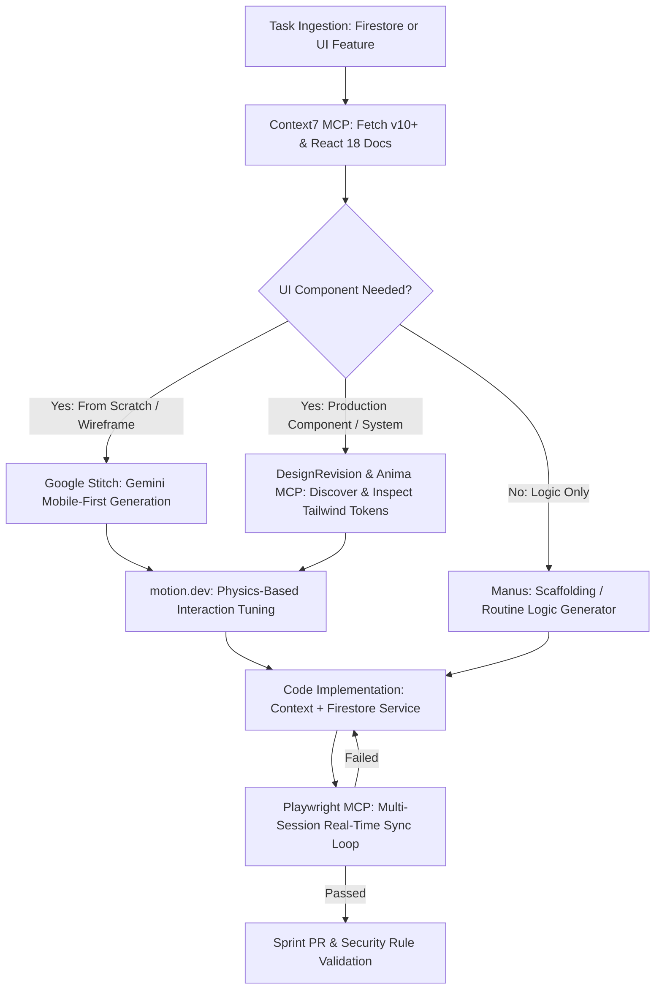
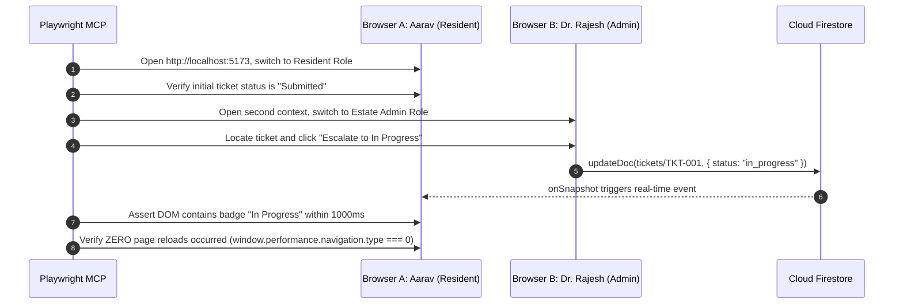

# CEP Sprint-2: Cloud Firestore Migration & Real-Time Syncing Playbook

> **Role:** Senior Software Architect Operational Directives  
> **Target Platform:** React 18 + Vite + Tailwind CSS (v3.4+) + Firebase SDK (v10.8+) + Python FastAPI Backend  
> **Sprint Focus:** Migrate state management from `localStorage` to Google Cloud Firestore with real-time reactive sync, mobile-first UI excellence, and zero application regressions.

---

## 1. Architectural Guardrails & Strict Coding Standards

### 1.1 Firebase SDK v10+ Modular Syntax Enforcement
1. **Never use Firebase v8 or v9-compat namespaced syntax.**
   - ❌ **STRICTLY PROHIBITED:**
     ```javascript
     // NEVER WRITE THIS:
     import firebase from 'firebase/compat/app';
     import 'firebase/compat/firestore';
     const db = firebase.firestore();
     db.collection('tickets').doc(id).get();
     ```
   - ✅ **MANDATORY MODULAR SYNTAX:**
     ```javascript
     import { 
       collection, 
       doc, 
       getDocs, 
       getDoc, 
       setDoc, 
       updateDoc, 
       deleteDoc, 
       query, 
       where, 
       orderBy, 
       limit, 
       onSnapshot, 
       serverTimestamp 
     } from 'firebase/firestore';
     import { db } from '../services/firebase';
     ```

2. **Server Timestamps:**
   - Always use `serverTimestamp()` for `createdAt` and `updatedAt` fields. Never use client-side `new Date().toISOString()` for database timestamps to prevent clock skew across client devices.

3. **Data Schemas & Document ID Conventions:**
   - `users/{uid}`: Managed by Firebase Auth UID. Fields: `email`, `name`, `role` (`"resident" | "wing_rep" | "admin" | "ngo"`), `wing`, `communityId`, `createdAt`.
   - `communities/{communityId}`: Unique slug or auto-ID. Fields: `name`, `city`, `nomenclature` (`{ wingLabel: "Wing" | "Hostel Block" }`), `createdAt`.
   - `tickets/{ticketId}`: Auto-generated document ID. Fields: `title`, `description`, `category` (`"Electrical" | "Plumbing" | "Sanitation" | "General"`), `urgency` (`"Low" | "Medium" | "High"`), `status` (`"submitted" | "verified" | "in_progress" | "resolved" | "rejected"`), `residentId`, `residentName`, `communityId`, `wing`, `imageUrl`, `upvotes` (number), `createdAt`, `updatedAt`.
   - `challenges/{challengeId}`: Auto-generated document ID. Fields: `title`, `description`, `ngoId`, `ngoName`, `communityId`, `tags`, `status` (`"open" | "claimed" | "completed"`), `claimedBy`, `createdAt`.

### 1.2 React Context Memory Leak Prevention & Lifecycle Rules
1. **Mandatory Unsubscribe Cleanups:**
   - Every `onSnapshot` listener attached inside a `useEffect` hook **MUST return its unsubscribe callback function**. Failure to do so causes orphan listeners, memory leaks, duplicate re-renders, and catastrophic Firebase bill spikes.
   - ✅ **Canonical Pattern for `CommunityContext.jsx`:**
     ```javascript
     useEffect(() => {
       if (!user?.communityId) {
         setTickets([]);
         setLoading(false);
         return;
       }

       const q = query(
         collection(db, 'tickets'),
         where('communityId', '==', user.communityId),
         orderBy('createdAt', 'desc')
       );

       const unsubscribe = onSnapshot(
         q,
         (snapshot) => {
           const updatedTickets = snapshot.docs.map((docSnap) => ({
             id: docSnap.id,
             ...docSnap.data()
           }));
           setTickets(updatedTickets);
           setLoading(false);
         },
         (error) => {
           console.error('Firestore onSnapshot subscription error:', error);
           setError(error.message);
           setLoading(false);
         }
       );

       // STRICT RULE: Return the unsubscribe function
       return () => unsubscribe();
     }, [user?.communityId]);
     ```

2. **Optimistic Updates & Error Rollbacks:**
   - When updating local state (e.g., ticket upvote, status toggle), update React state immediately for snappy user perception, but handle rejected Firestore promises with graceful error notifications and state rollbacks.

3. **Firestore Security Rules Standard:**
   - Access must require `request.auth != null`.
   - Residents may only read/create tickets where `request.resource.data.communityId == resource.data.communityId`.
   - Wing Reps may only escalate tickets belonging to their assigned wing.
   - Admins possess cross-wing status modification privileges within their community.

---

## 2. Tool Integration Protocols



### 2.1 Context7 MCP (Documentation Verification Engine)
- **Role:** Fetches authoritative, version-locked documentation to eliminate SDK hallucination and legacy syntax.
- **Mandatory Prerequisite:** Before writing or proposing any Cloud Firestore query, transaction, batch write, or React 18 Context subscriber, execute a Context7 query.
- **Rules of Engagement:**
  1. Always query for `firebase@10` or `@firebase/firestore` modular syntax.
  2. Query syntax for React 18 state synchronization: verify hook concurrency guidelines and cleanup patterns.
  3. Validate that methods like `enableIndexedDbPersistence` vs `initializeFirestore` with `persistentLocalCache` match Firebase v10+ best practices.
  4. Flag any legacy `firebase.firestore.FieldValue.serverTimestamp()` in favor of `serverTimestamp()`.

### 2.2 DesignRevision MCP & Anima MCP (UI Design-to-Code Pipeline)
- **Role:** Import production-grade, accessible, mobile-first Tailwind CSS components instead of hand-writing generic, unstyled markup.
- **Anti-Generic Markup Mandate:**
  - ❌ **BANNED:** Never emit raw HTML without responsive design tokens, accessible ARIA attributes, or tactile states (e.g., `<div><button>Submit</button></div>`).
  - ✅ **REQUIRED:**
    1. **DesignRevision MCP:** Use to inspect, preview, and select real-world, mobile-optimized component templates (ticket cards, filter chips, urgent alert banners, stats widgets).
    2. **Anima MCP:** Use to connect Figma tokens directly to React Tailwind code, ensuring pixel-perfect alignment with CEP's glassmorphism theme:
       - Dark / Modern Indigo background: `bg-slate-900/90 backdrop-blur-md border border-slate-800/80`
       - Status badge tokens: `text-emerald-400 bg-emerald-950/60 border-emerald-800/50`
       - Accessibility: Proper `aria-live="polite"` for dynamic ticket updates, accessible labels on action triggers, high-contrast text ratios (`text-slate-100` on dark cards).

### 2.3 Google Stitch (Gemini-Powered Screen & Wireframe Synthesis)
- **Role:** Converts high-level functional prompts, mobile user journeys, and hand sketches into structured, semantic HTML/Tailwind screens.
- **Usage Rules:**
  1. Use Google Stitch when prototyping new mobile screens for Sprint 2 (e.g., Mobile Resident Quick-Reporting Drawer, Wing Rep Batch-Review Card, Offline-Mode Network Warning Banner).
  2. Feed Stitch structured design prompts detailing:
     - Persona viewpoint (Resident vs Wing Rep vs Admin).
     - Screen density (compact mobile viewport `375px` to `430px`).
     - Visual tone: Sleek glassmorphism with dynamic status badges and Lucide icon placements.
  3. Inspect Stitch-generated HTML/Tailwind outputs and extract modular React components directly into `frontend/src/components/`.

### 2.4 motion.dev (Physics-Based Interaction & Anti-Slop Guidelines)
- **Role:** Enforces natural, spring-physics micro-interactions while completely banning UI slop, layout thrashing, and laggy transitions.
- **The "Anti-Slop" Manifesto:**
  - ❌ **No Linear Easing:** Never use `ease-in-out` or linear durations on tactile buttons, swipeable cards, or modals. Linear easing feels robotic and unnatural.
  - ❌ **No Layout-Thrashing Animations:** Never animate `height`, `width`, `top`, `left`, or `margin`. These trigger full browser layout recalculations and cause stutter on mobile devices.
  - ✅ **Compositor-Only Animations:** Restrict all animated properties to GPU-accelerated transforms: `transform` (`x`, `y`, `scale`) and `opacity`.
  - ✅ **Physics-Based Springs:** Always use calibrated spring mechanics for interactive elements:
    ```javascript
    import { motion } from 'motion/react';

    // Canonical Spring Configuration for Cards & Buttons
    export const springTransition = {
      type: "spring",
      stiffness: 350,
      damping: 25,
      mass: 0.8
    };

    export const TicketCardMotion = ({ children }) => (
      <motion.div
        layout
        initial={{ opacity: 0, y: 16 }}
        animate={{ opacity: 1, y: 0 }}
        exit={{ opacity: 0, scale: 0.96 }}
        transition={springTransition}
        whileHover={{ scale: 1.015, y: -2 }}
        whileTap={{ scale: 0.98 }}
        className="bg-slate-900/80 backdrop-blur border border-slate-800 rounded-xl p-4 shadow-lg"
      >
        {children}
      </motion.div>
    );
    ```
  - **MotionScore Performance Audits:** Use the motion tooling to audit component jank, verify 60fps performance on mobile viewports, and eliminate unnecessary re-renders during Firestore real-time updates.

### 2.5 Manus (Subagent Delegation Protocol)
- **Role:** Autonomous subagent execution for routine component boilerplate, mock generation, and test suite scaffolding.
- **Delegation Protocol:**
  1. **Strict Scoping:** When delegating to Manus or subagents, provide an exact input contract, file destination, and acceptance criteria.
  2. **Subagent Tasks Permitted:**
     - Generating mock Firestore JSON fixtures.
     - Writing pure UI presentational components with Tailwind props.
     - Generating unit test skeletons for service helpers.
  3. **Mandatory Architect Gate:** Every Manus-generated snippet must be validated against:
     - Firebase v10+ modular import compliance.
     - React Context unsubscribe rule compliance.
     - Mobile-first responsiveness and Tailwind class hygiene.

### 2.6 Playwright MCP (Real-Time Reactive Testing Loop)
- **Role:** Drives headless browser instances to deterministically verify that Firestore `onSnapshot` listeners correctly update the DOM across concurrent sessions without requiring manual page reload.
- **The Mandatory Testing Loop:**



- **Execution Step-by-Step:**
  1. **Dual-Context Initialization:** Spawn two independent browser contexts (Context A: Resident, Context B: Estate Admin).
  2. **Baseline Verification:** Resident page renders current list of tickets from Firestore collection. Record timestamp.
  3. **Mutation Trigger:** Admin context executes a status change on ticket (e.g. from `submitted` to `in_progress` or `resolved`).
  4. **Dynamic DOM Assertion:** Resident context must reflect the updated badge and timestamp within 1500ms **without invoking `page.reload()`**.
  5. **Network & Console Audit:** Verify zero console errors, zero uncaught promise rejections, and no infinite Firestore polling network requests.

---

## 3. Sprint-2 Execution Workflow & Checklist

| Step | Phase | Action Item | Primary Tool | Verification Gate |
| :--- | :--- | :--- | :--- | :--- |
| **01** | **Documentation Check** | Query modular Firebase v10+ Firestore syntax and React 18 hook cleanup rules. | **Context7 MCP** | Verify zero deprecated v8/compat methods in plan. |
| **02** | **Design & Token Alignment** | Discover and extract accessible mobile-first Tailwind components for tickets, stats, and filters. | **DesignRevision / Anima** | Meets glassmorphism palette and WCAG contrast. |
| **03** | **Rapid Screen Prototyping** | Generate mobile drawer and alert screens from structured prompts. | **Google Stitch** | Responsive layout down to 375px mobile viewport. |
| **04** | **Interaction Physics** | Apply spring physics and compositor-only transforms. Eliminate animation slop. | **motion.dev** | 60 FPS compositor execution, no layout thrash. |
| **05** | **Boilerplate Delegation** | Delegate routine mock schemas and presentational components with strict contract. | **Manus** | Architect code-review against modular standards. |
| **06** | **Firestore Sync Integration** | Wire modular `onSnapshot` queries into `CommunityContext.jsx` with strict unsubscribe cleanups. | **Manual / Architect** | Memory leak-free, clean unmounts. |
| **07** | **Multi-Session Testing Loop** | Execute dual-session browser test asserting instant DOM reactivity on mutation. | **Playwright MCP** | Cross-device instant sync verified without page reload. |
| **08** | **Security & Rules Validation** | Confirm collection isolation and auth checks (`request.auth != null`). | **Firebase Emulator / Rules** | Unauthenticated and cross-community access denied. |

---

## 4. Troubleshooting & Escalation Matrix

- **Issue: `FirebaseError: Expected first argument to collection() to be a CollectionReference`**
  - *Cause:* Passing undefined database instance or mixing v8/v10 syntax.
  - *Resolution:* Query Context7 MCP for `getFirestore` initialization; ensure `import { db } from '../services/firebase'` exports modular `getFirestore(app)`.
- **Issue: Maximum update depth exceeded in React component**
  - *Cause:* Triggering state updates inside `onSnapshot` without comparing document changes or unstable dependency array in `useEffect`.
  - *Resolution:* Use stable reference keys (`user?.communityId`), ensure snapshot callback maps cleanly without referencing mutating objects.
- **Issue: Playwright test fails to see DOM update within timeout**
  - *Cause:* Firestore security rules rejecting write, or missing `onSnapshot` query index.
  - *Resolution:* Check browser console in Playwright trace. Verify composite index in Firebase console for compound queries (`communityId` + `createdAt`).
- **Issue: Janky card transitions on mobile**
  - *Cause:* Animating `height: auto` or using CSS `transition: all 0.3s ease`.
  - *Resolution:* Swap to `motion/react` with `<motion.div layout>` and spring physics.

---
*End of Operational Playbook — All agent actions in Sprint 2 must strictly adhere to this specification.*
