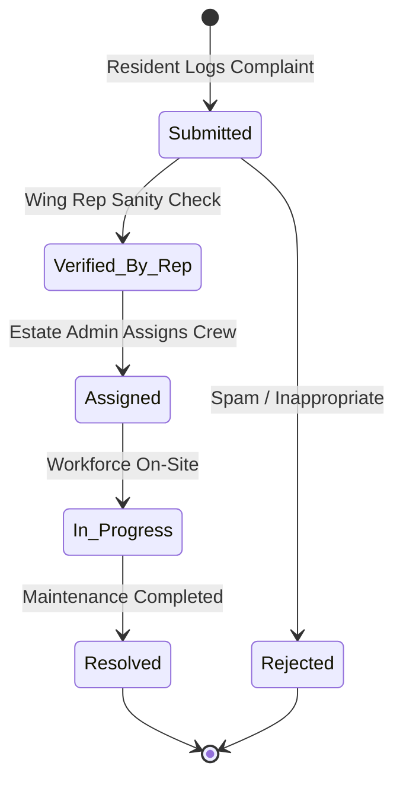

# Technical Architecture Specification
**AI Community Digital Problem Observatory**

---

## 1. System Topology

```mermaid
graph TD
    subgraph Client [Frontend — React 18 + Vite]
        A[AuthContext.jsx] --> B[CommunityContext.jsx]
        B --> C[ResidentDashboard.jsx]
        B --> D[WingRepDashboard.jsx]
        B --> E[AdminDashboard.jsx]
        B --> F[NGOMarketplace.jsx]
        B --> G[Scoreboard.jsx]
    end

    subgraph Backend [FastAPI AI & Alert Gateway — Render]
        H[/api/tickets/analyze] --> I[Gemini 3.8 Flash]
        J[/api/tickets/deduplicate] --> I
        K[/api/reports/generate] --> I
        L[/api/notifications/sms] --> M[Twilio Gateway]
        N[/api/notifications/email] --> O[Resend Gateway]
    end

    subgraph Database [Firebase Cloud Services]
        P[Firebase Authentication]
        Q[Cloud Firestore Modular v10+]
        R[Firebase Storage]
    end

    Client -->|REST| Backend
    Client -->|Modular SDK| P
    Client -->|onSnapshot Listeners| Q
```

---

## 2. Escalation & Verification Pipeline



### SLA Targets:
- **AI Categorization & Deduplication:** Real-time (<1.5 seconds) during user typing or on submission.
- **Wing Rep Sanity Check:** Target acknowledgment <2 hours.
- **SMS Alert to Estate Admin:** Dispatched automatically within 30 seconds of Wing Rep clicking "Verify & Escalate".
- **Resident Status Notification:** Triggered immediately when Estate Admin updates ticket status.

---

## 3. Data Isolation Model (Demo vs. Production)

To prevent evaluator actions or mock test data from compromising real society/hostel records, the application implements physical collection-level isolation:

```
Cloud Firestore
├── /users/{uid}                 <-- Production Authenticated Users
├── /communities/{commId}        <-- Production Registered Societies
├── /tickets/{ticketId}          <-- Production Community Tickets
├── /challenges/{chId}           <-- Production NGO Challenges
│
└── /demo_users/{uid}            <-- Isolated Demo User Profiles
└── /demo_communities/{commId}   <-- Isolated Demo Societies
└── /demo_tickets/{ticketId}     <-- Isolated Demo Complaints
└── /demo_challenges/{chId}      <-- Isolated Demo NGO Projects
```

### Enforcement Rules:
1. When browsing `https://cep-seven.vercel.app/demo`, all reads and writes route to `demo_*` collections.
2. Production users at `https://cep-seven.vercel.app/` route exclusively to production collections.
3. Firestore security rules strictly isolate collections to prevent cross-environment pollution.

---

## 4. Cloud Firestore Security Rules

The security rules enforce role-based access control and authenticated boundaries:
- **`users/{uid}`**: Any authenticated user can read; users can only write and update their own document (`request.auth.uid == uid`).
- **`tickets/{ticketId}`**: Authenticated residents in the community can read; creation requires `resident_id == request.auth.uid`; updates restricted to Wing Reps (`isWingRep`) or Estate Admins (`hasRole('admin')`).
- **`challenges/{challengeId}`**: Publicly readable by all authenticated community members; claimable by students; editable by the posting NGO.
- **`demo_*`**: Open to authenticated demo sessions for uninterrupted interactive evaluations.
