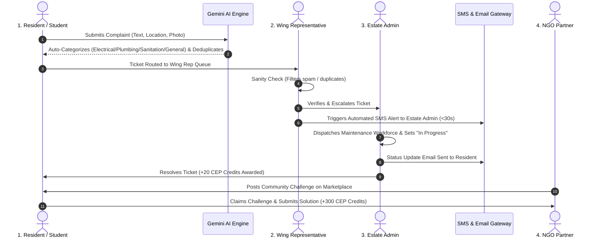

# AI Community Digital Problem Observatory 🛡️
> **Community Engagement Project (CEP) Platform**  
> Centralized, intelligent civic problem reporting, automated Gemini AI categorization & deduplication, multi-community hierarchy customization, 30s authority SMS alerts, photo evidence attachments, and NGO challenge marketplace with CEP credit gamification.

[](https://cep-seven.vercel.app/)
[](https://cep-seven.vercel.app/demo)
[](https://console.firebase.google.com/u/0/project/cep-ai/overview)

---

## 🌟 Overview

The **AI Community Digital Problem Observatory** replaces chaotic WhatsApp groups, lost verbal complaints, and paper registers in hostels, residential housing societies, and university campuses with an intelligent, transparent, and accountable pipeline.

It bridges residents, wing representatives, estate administrators, and local NGOs into a structured problem-to-resolution lifecycle powered by **Google Gemini AI** and **Firebase Cloud Firestore**.

---

## 🔄 End-to-End Problem Lifecycle Workflow



### The 4 Standardized System Personas:
1. **Resident / Student (Indigo Identity):**
   - Submit natural language complaints with photo evidence and location.
   - Real-time Gemini AI preview (Category: Electrical, Plumbing, Sanitation, General; Urgency: Low, Medium, High).
   - Automated semantic deduplication gate preventing duplicate submissions.
   - Upvote active community complaints to boost maintenance priority.
   - Claim NGO challenges to earn academic CEP credits.
2. **Wing Representative (Emerald Identity):**
   - Filtered strictly to their assigned division/wing (e.g., Wing A).
   - Local sanity check: "Verify & Escalate" or "Flag as Spam / Reject".
   - Automated 30s SMS alert dispatched to Estate Admin upon verification.
   - Dynamic honor badges ("Wing Leader", "Master Verifier").
3. **Estate Admin (Purple Identity):**
   *(Standardized across code, UI, and documentation; formerly referred to as Chief Warden in hostel settings)*
   - Aggregated cross-wing verified ticket register.
   - Maintenance workforce dispatch (assign technician crews, track progress).
   - Gemini AI executive management briefing summarizing community health and action items.
4. **NGO Partner (Teal Identity):**
   - Marketplace for publishing operational challenges (IoT monitoring, waste audits, rural education).
   - Review and accept student project submissions for social impact certification and CEP credits.

---

## 🔒 Demo vs. Production Separation Architecture

To guarantee absolute data integrity, the **Production Application** and the **Demonstration Environment** operate on distinct routes with strictly isolated datastores:

| Parameter | Production Application (`/` or `/app`) | Demo Environment (`/demo`) |
|---|---|---|
| **Route Endpoint** | `https://cep-seven.vercel.app/` | `https://cep-seven.vercel.app/demo` |
| **Data Isolation** | Real Cloud Firestore collections: `tickets`, `communities`, `users`, `challenges` | Isolated collections: `demo_tickets`, `demo_communities`, `demo_challenges`, `demo_users` |
| **Authentication** | Real Firebase Auth user accounts only | Seeded 1-Click Evaluation Personas + Demo Accounts |
| **Write Protection** | Firestore Security Rules strictly block demo writes from modifying real data | Isolated to `demo_*` collections; zero production pollution |
| **Persona Switcher** | Hidden (real user profiles only) | Visible top evaluation toolbar (`1. Resident`, `2. Wing Rep`, `3. Estate Admin`, `4. NGO`) |

---

## 📊 Cloud Firestore Schema Reference

### 1. `users/{uid}`
```typescript
interface UserDocument {
  email: string;              // "aarav@campus.edu"
  displayName: string;        // "Aarav Sharma"
  role: "resident" | "wing_rep" | "admin" | "ngo";
  communityId: string;       // "comm_emerald_1"
  community_id: string;      // Normalized legacy alias
  wing: string;              // "Wing A"
  room_number: string;       // "A-304"
  phone: string;             // "+91 98765 43210"
  cepCredits: number;        // Gamification points balance (e.g. 450)
  createdAt: string;         // ISO-8601 timestamp
}
```

### 2. `tickets/{ticketId}`
```typescript
interface TicketDocument {
  ticket_id: string;         // "TICK-8021"
  title: string;             // "Main corridor ceiling fan sparking"
  description: string;       // Detailed problem statement
  category: "Electrical" | "Plumbing" | "Sanitation" | "General";
  urgency: "Low" | "Medium" | "High";
  status: "Submitted" | "Verified_By_Rep" | "Assigned" | "In_Progress" | "Resolved" | "Rejected";
  resident_id: string;       // Submitter UID
  resident_name: string;     // Submitter display name
  community_id: string;      // "comm_emerald_1"
  wing: string;              // "Wing A"
  room_number: string;       // "A-304"
  image_url: string | null;  // Photo evidence URL or data preset
  upvotes: number;           // Community urgency validation counter
  upvoted_by: string[];      // Array of resident UIDs who validated the issue
  verified_by: string | null;// "Vikram Malhotra (Wing Rep)"
  assigned_worker: string | null; // e.g., "Apex Electricals"
  ai_summary: string;        // Objective 1-2 sentence AI defect summary
  suggested_action: string;  // Concrete recommendation from Gemini AI
  server_created_at: Timestamp;
  server_updated_at: Timestamp;
}
```

### 3. `communities/{communityId}`
```typescript
interface CommunityDocument {
  community_id: string;      // "comm_emerald_1"
  name: string;              // "Emerald Heights Campus Hostel"
  type: "hostel" | "housing_society" | "rwa_colony" | "ngo_hub" | "custom";
  city: string;              // "Bengaluru"
  wings: string[];           // ["Wing A", "Wing B", "Wing C", "Wing D"]
  admin_uid: string;         // UID of the Estate Admin
  nomenclature: {
    reporter_label: string;  // "Resident / Student"
    verifier_label: string;  // "Wing Representative"
    authority_label: string; // "Estate Admin"
    division_label: string;  // "Wing"
  };
  members: Array<{ uid: string; name: string; role: string }>;
  created_at: string;
}
```

### 4. `challenges/{challengeId}`
```typescript
interface ChallengeDocument {
  challenge_id: string;      // "NGO-CH-101"
  ngo_name: string;          // "CleanCity & EcoGreen NGO"
  title: string;             // "AI Image Model for Waste Auditing"
  description: string;       // Operational bottleneck description
  skills_required: string[]; // ["React", "Python", "Computer Vision"]
  status: "Open" | "Claimed" | "In_Review" | "Closed";
  claimed_by_user_id: string | null;
  claimed_by_user_name: string | null;
  contact_email: string;     // NGO contact bridge
  reward: string;            // "Certificate + 300 CEP Credits"
  created_at: string;
}
```

---

## 🎯 Pitch Deck Feature Implementation Audit

| Pitch Deck Feature | Status | Implementation Details |
|---|---|---|
| **AI Classification** | **Implemented** | Gemini 3.8 Flash via FastAPI `POST /api/tickets/analyze` with intelligent regex fallback. |
| **Urgency Scoring** | **Implemented** | Tri-level priority (`Low`, `Medium`, `High`) derived from incident severity cues. |
| **Semantic Deduplication** | **Implemented** | Gemini semantic embedding similarity via `POST /api/tickets/deduplicate`. Verified blocking gate before Firestore write. |
| **SMS Alerts (<30s)** | **Implemented** | Twilio integration (`/api/notifications/sms`) with guaranteed sub-30s simulated dispatch logging for authority alerts on Wing Rep verification. |
| **Email Verification & Alerts** | **Implemented** | Resend email dispatch (`/api/notifications/email`) on status progression (`In_Progress`, `Resolved`). |
| **NGO Challenge Marketplace** | **Implemented** | Dedicated board for posting, filtering, claiming, and tracking social impact problems. |
| **QR-Code Onboarding** | **Implemented** | Dynamic printable QR codes for community joining (`/?action=join&community=...`) and location-specific complaint spots. |
| **Gamification & Scoreboard** | **Implemented** | Honor Roll leaderboard tracking CEP credits, student contributions, and wing resolution velocity. |
| **Community Upvotes** | **Implemented** | Community validation button on `TicketCard.jsx` with persistent Firestore counters. |
| **Wing Rep Badges** | **Implemented** | Dynamic honor badges ("Wing Leader", "Master Verifier") awarded on verification milestones. |

---

## 📚 Documentation Reference

- **[SETUP.md](./SETUP.md):** Complete local setup, environment variables, Docker instructions, and Playwright automated testing.
- **[ARCHITECTURE.md](./ARCHITECTURE.md):** Deep-dive system architecture, notification event pipeline, and security model.
- **[TEACHER_ASSESSMENT_GUIDE.md](./TEACHER_ASSESSMENT_GUIDE.md):** Oral viva defense matrix, rubric alignment, and evaluation guide.
