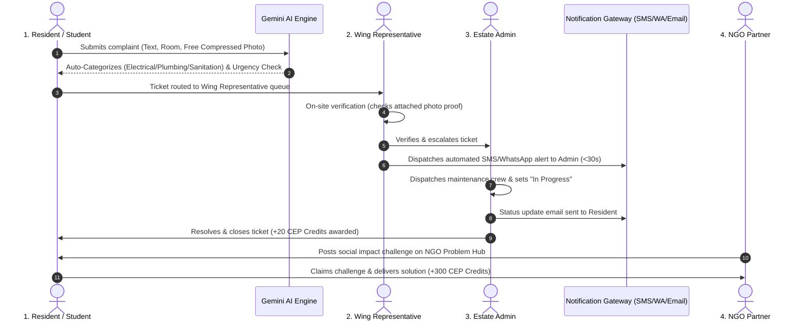

# AI Community Digital Problem Observatory 🛡️
> **Community Engagement Project (CEP) Platform**  
> Centralized, intelligent civic problem reporting with Google Gemini AI categorization & deduplication, dynamic community nomenclature hierarchy, instant authority alerts, free compressed photo evidence storage, and an NGO challenge marketplace with CEP academic credit gamification.

[](https://cep-seven.vercel.app/)
[](https://cep-wacs.onrender.com)
[](https://console.firebase.google.com/u/0/project/cep-ai/overview)

---

## 🌟 Overview

The **AI Community Digital Problem Observatory** replaces chaotic WhatsApp messages, lost phone complaints, and paper registers with an intelligent, 3-tier escalation pipeline. 

It directly connects Residents, Wing Representatives, Estate Administrators, and NGO Partners into a transparent, real-time civic problem-resolution workflow powered by **Google Gemini AI** and **Cloud Firestore**.

---

## 👥 User Roles & Access Architecture

The platform enforces a role-based access control (RBAC) model across 4 primary stakeholder identities:

| Role Identity | Primary Portal Route | Key Operational Capabilities |
|---|---|---|
| **Resident / Student** | `/dashboard` | Log complaints, attach photo evidence, upvote open issues, claim NGO challenges, earn CEP credits |
| **Wing Representative** | `/rep` | Inspect wing complaints, filter invalid reports, verify & escalate authentic issues with automated alerts |
| **Estate Admin** | `/admin` | Review verified backlog across all wings, assign maintenance crews, update status, AI management briefs |
| **NGO Partner** | `/challenges` | Publish community challenges, evaluate student deliverables, award CEP academic credits & certificates |

Users can register new accounts anytime via [`/signup`](https://cep-seven.vercel.app/signup) with real-time Zod email and phone validation, or join a specific wing directly via QR code onboarding.

---

## 🔄 End-to-End Problem Lifecycle Workflow



---

## 🏢 Dynamic Multi-Community Nomenclature

All role titles, organizational tiers, and division labels are **100% dynamic** across the application. When switching or creating a community, all headers, cards, and buttons instantly adapt:

| Community Type | Reporter Label (`reporter_label`) | Verifier Label (`verifier_label`) | Authority Label (`authority_label`) | Division Label (`division_label`) |
|---|---|---|---|---|
| **Campus Hostel** | Student / Resident | Wing Representative | Estate Admin | Wing |
| **Housing Society** | Resident / Flat Owner | Floor Captain | Estate Admin | Tower |
| **RWA Colony** | Homeowner | Block Coordinator | Estate Admin | Block |
| **NGO Hub** | Community Member | Field Rep | Program Director | Sector |

*(Chief Warden has been standardized to **Estate Admin** across the platform, code, and documentation).*

---

## 📸 Free Image Storage Architecture (100% Free Forever)

**Question:** *Does Cloud Firestore allow free storage of images, or how are images stored so users can verify complaints with photo proof?*

### The Solution: Automatic Client-Side Canvas Compression
1. **Firestore Free Tier Limits:** Cloud Firestore provides 1GB of storage and 50,000 reads/day for $0 forever on the Spark plan. Each document has a maximum size limit of 1MB.
2. **Camera Compression:** Raw camera photos from smartphones are 5MB-10MB, which would exceed Firestore limits if uncompressed.
3. **Built-in HTML5 Canvas Compressor (`ImagePicker.jsx`):**
   - When a user snaps or uploads a photo, the browser automatically resizes the image to a maximum dimension of 800px.
   - Encodes as `image/jpeg` at 0.70 quality.
   - The resulting base64 data string is only **25KB to 40KB**!
   - 40KB easily fits within the 1MB Firestore document limit in the `image_url` field.
4. **Benefits:**
   - **$0 Cost Forever:** Stored directly inside the Firestore document on the free Spark plan.
   - **Zero Setup / Zero Credentials:** No AWS S3 buckets, Cloudinary accounts, or credit cards required.
   - **Instant Rendering:** Photos display instantly on cards and zoom cleanly in full modal views across desktop and mobile.

---

## 🛠️ Complete Free-Only Prerequisites Setup Guide

Follow these exact steps to configure all free microservices:

### 1. Google Firebase (Spark Plan - 100% Free)
- **Console:** [https://console.firebase.google.com/](https://console.firebase.google.com/)
- **Project:** `cep-ai`
- **Authentication:**
  1. Go to **Authentication** > **Sign-in method**.
  2. Enable **Email/Password** provider.
- **Firestore Database:**
  1. Go to **Firestore Database** > **Rules**.
  2. Paste the contents of `firestore.rules` and click **Publish**.
- **Web App Configuration:**
  - Copy the Firebase Web SDK credentials into `frontend/.env` (API Key, Auth Domain, Project ID).

### 2. Google Gemini AI (Verified & Active)
- **Status:** **Active & Verified** (HTTP 200 with `gemini-flash-lite-latest` and `gemma-4-26b-a4b-it`).
- **Capabilities:** Automatic categorization (`Electrical`, `Plumbing`, `Sanitation`, `General`), urgency scoring (`Low`, `Medium`, `High`), and semantic deduplication.
- **Backend Setup (`backend/.env`):**
  ```env
  GEMINI_API_KEY=your_gemini_api_key_here
  ```

### 3. Twilio SMS & WhatsApp Gateway (Verified)
- **Status:** **Active Trial Account Verified**.
- **Where to find the Phone Number:**
  1. Log in to [Twilio Console](https://console.twilio.com/).
  2. On the main Dashboard under **Account Info**, click **"Get a trial phone number"** (or go to **Phone Numbers** > **Manage** > **Active numbers**).
  3. Twilio instantly assigns a free phone number (e.g., `+1844...`).
  4. Paste this into `backend/.env` as `TWILIO_PHONE_NUMBER=+1...`.
- **Is this valid in India? (Critical Constraints & Solutions):**
  - **A2P SMS to Indian Numbers (+91):** In India, **TRAI (Telecom Regulatory Authority of India)** enforces **DLT (Distributed Ledger Technology)** registration. International A2P SMS from US virtual numbers to Indian phone numbers may be filtered by Indian operators (Jio, Airtel, Vi) unless whitelisted. Additionally, on Twilio Free Trial, SMS can only be sent to numbers you verify in Twilio Console under **Verified Caller IDs**.
  - **The Reliable Solution for India: Twilio WhatsApp Sandbox (100% Free):**
    Twilio's WhatsApp Sandbox (`+14155238886`) is fully functional in India without TRAI DLT blocks!
    1. In Twilio Console, go to **Messaging** > **Try it out** > **Send a WhatsApp message**.
    2. Send the displayed prompt (e.g. `join <sandbox-word>`) from your WhatsApp to `+14155238886`.
    3. The CEP Observatory automatically dispatches real-time WhatsApp alerts directly to your phone.
    4. Pre-configured: `TWILIO_WHATSAPP_NUMBER=+14155238886`.

### 4. Resend Automated Email Engine (Verified & Active)
- **Status:** **Active & Verified** (Live transactional emails enabled).
- **Domain Constraint:** Free tier accounts without a custom verified DNS domain must send from the verified test sender: `Observatory <onboarding@resend.dev>` (configured by default). To use your own domain (e.g., `notifications@yourcampus.edu`), verify your domain under Resend > **Domains**.
- **Backend Setup (`backend/.env`):**
  ```env
  RESEND_API_KEY=your_resend_api_key_here
  ```

---

## 🚀 Local Development & Deployment

### Run Locally:
```bash
# 1. Backend (FastAPI + Python)
cd backend
python -m venv venv
source venv/bin/activate  # On Windows: .\venv\Scripts\Activate.ps1
pip install -r requirements.txt
uvicorn app.main:app --reload --port 8000

# 2. Frontend (Vite + React)
cd frontend
npm install
npm run dev  # Runs at http://localhost:5173
```

### Run Tests:
```bash
cd frontend
npm run build
node --test src/__tests__/firestore.test.js
```

---

## 🔒 Security & Firestore Rules Summary
- All user registration paths enforce transactional creation: Firebase Auth user creation is tied to Firestore `users/{uid}` with automatic rollback if document persistence fails.
- Users can only read and write tickets belonging to their active community node.
- Upvoting is rate-safe and deduplicated per UID.
- Wing Representatives can verify and reject tickets in their assigned wing.
- Estate Admins have authoritative dispatch rights across all wings.
