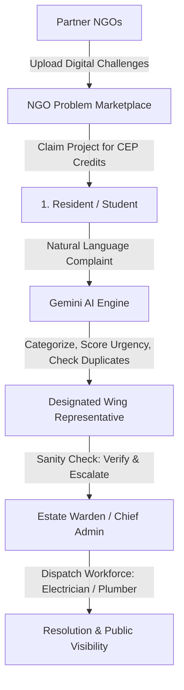

# CEP - AI Community Digital Problem Observatory 🛡️
> **Community Engagement Project (CEP) Platform**  
> Centralized, intelligent complaint tracking, automated Gemini AI categorization & deduplication, multi-community hierarchy customizer, photo evidence attachments, and NGO problem-solving marketplace.

---

## 🌟 Overview & Architecture

The **AI Community Digital Problem Observatory** replaces chaotic WhatsApp groups and paper registers in colleges, hostels, and residential societies with an intelligent, accountable pipeline.



### Key Role-Based Personas:
1. **Resident / Student (Indigo Identity):**
   - Natural language complaint submission in any language.
   - Real-time Gemini AI preview (Category: Electrical, Plumbing, Sanitation, General; Urgency: Low, Medium, High).
   - Automated deduplication detection to prevent spamming.
   - Interactive tracking of personal complaints.
2. **Wing Representative (Emerald Identity):**
   - Filtered strictly to their assigned wing (e.g. Wing A).
   - Local sanity check: "Verify & Escalate" or "Flag as Spam / Reject".
3. **Estate Warden / Admin (Purple Identity):**
   - Aggregated cross-wing feed of verified tickets.
   - Workforce assignment (dispatch technicians and update progress).
   - Gemini AI executive management briefing summarizing community infrastructural health.
4. **NGO Partner (Teal Identity):**
   - Problem statement marketplace where NGOs post operational bottlenecks.
   - Engineering students claim challenges to build software/hardware solutions.

---

## 🚀 Quick Start Guide

### 1. Prerequisites
- **Node.js**: v18+ (tested on Node v24)
- **Python**: v3.10+ (tested on Python 3.14)

---

### 2. Backend Setup (FastAPI + Google Gemini)

```bash
cd backend

# Create virtual environment (optional)
python -m venv venv
# On Windows:
venv\Scripts\activate
# On Linux/macOS:
# source venv/bin/activate

# Install dependencies
pip install -r requirements.txt

# (Optional) Add your Google Gemini API Key in .env
# If left blank, the built-in intelligent heuristic engine takes over automatically
echo GEMINI_API_KEY=your_gemini_api_key_here > .env

# Start FastAPI server
uvicorn app.main:app --reload --port 8000
```
API Documentation will be live at: `http://localhost:8000/docs`

---

### 3. Frontend Setup (React + Vite + Tailwind CSS)

```bash
cd frontend

# Install dependencies
npm install

# Start Vite development server
npm run dev
```
Open your browser at: `http://localhost:5173`

---

## 🧭 Live Demo & 1-Click Role Switcher

For assessment presentations and teacher grading, the top navigation bar features a **1-Click Evaluation Persona Switcher**:
- Click **"1. Resident"** -> Log in as *Aarav Sharma (Resident, Wing A)*
- Click **"2. Wing Rep (A)"** -> Log in as *Vikram Malhotra (Wing A Representative)*
- Click **"3. Estate Admin"** -> Log in as *Dr. Rajesh Iyer (Chief Warden & Estate Manager)*
- Click **"4. NGO Connect"** -> Log in as *Anita Deshmukh (GreenTech NGO Lead)*

---

## 📂 Repository Structure

```
c:/CEP/
├── .agents/
│   └── skills/
│       └── sprint-2-firestore/   # Workspace skill auto-discovery
│           └── SKILL.md
├── frontend/
│   ├── src/
│   │   ├── components/           # Navbar, Sidebar, TicketCard, StatusBadge, Modal, AIAnalysisModal, StatsCard, QRCodeModal
│   │   ├── context/              # AuthContext.jsx, CommunityContext.jsx
│   │   ├── pages/                # Login, Register, ResidentDashboard, WingRepDashboard, AdminDashboard, NGOMarketplace
│   │   ├── services/             # firebase.js (modular v10+), api.js
│   │   ├── App.jsx
│   │   ├── main.jsx
│   │   └── index.css
│   ├── package.json
│   ├── tailwind.config.js
│   └── vite.config.js
├── backend/
│   ├── app/
│   │   ├── api/                  # tickets.py (analyze, deduplicate), reports.py (AI executive summary)
│   │   ├── models/               # Pydantic schemas
│   │   ├── services/             # gemini_service.py (Gemini 1.5 Flash + fallback)
│   │   └── main.py               # FastAPI entrypoint with CORS
│   └── requirements.txt
├── .mcp.json                     # MCP Toolchain configuration
├── SKILL.md                      # Sprint 2 Firestore & Tooling Operational Playbook
├── MASTER_PROJECT_ROADMAP.md     # Phase and Sprint breakdown with PR templates
├── IMPLEMENTATION_FACTORS.md     # Technical factors, schemas, and architecture guide
├── TEACHER_ASSESSMENT_GUIDE.md   # Complete defense script, evaluation rubric, and next steps
└── README.md
```

---

## ⚡ Sprint 2: Cloud Firestore & Agent Tooling Framework

During Sprint 2, the CEP data layer migrates from `localStorage` to **Google Cloud Firestore v10+** with real-time syncing. All operations strictly adhere to the operational directives in [`SKILL.md`](./SKILL.md).

### Integrated Agent Toolchain (`.mcp.json`)
- **Context7 MCP:** Enforces version-specific verification of `@firebase/firestore` v10+ modular APIs and React 18 Context API before writing any database queries or mutations, completely eliminating deprecated v8/compat syntax.
- **DesignRevision & Anima MCP:** Extracts production-grade, accessible, mobile-first Tailwind CSS components matching our glassmorphism design system rather than writing generic markup.
- **Google Stitch:** Gemini-powered engine converting structured text prompts and sketches directly into high-fidelity HTML/CSS screens.
- **motion.dev:** Enforces physics-based spring transitions (`type: "spring", stiffness: 350, damping: 25`) with compositor-only properties (`transform`, `opacity`) under strict anti-slop guidelines.
- **Manus:** Subagent delegation workflow for routine component boilerplate, mock data generators, and test skeletons under architect review gates.
- **Playwright MCP:** Multi-session headless browser testing loop verifying that Firestore `onSnapshot` updates dynamically update the DOM across concurrent Resident and Admin sessions without page reload.

---

## 🛡️ Assessment & Defense Matrix

See [`TEACHER_ASSESSMENT_GUIDE.md`](./TEACHER_ASSESSMENT_GUIDE.md) for the exact 5-minute presentation script and answers to judge counter-questions on **Accountability**, **WhatsApp/SMS Alert Triggers**, and **Spam Prevention**.
