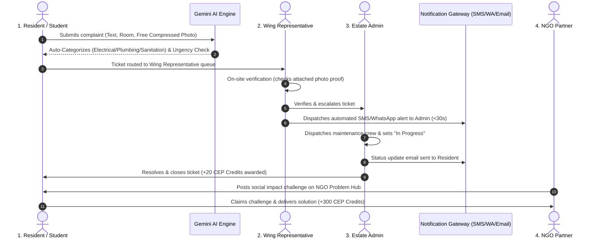

# AI Community Digital Problem Observatory 🛡️
> **Community Engagement Project (CEP) Platform**  
> Centralized, intelligent civic problem reporting with Google Gemini AI categorization & deduplication, dynamic community nomenclature hierarchy, instant authority alerts, free compressed photo evidence storage, and an NGO challenge marketplace with CEP academic credit gamification.

[](https://cep-seven.vercel.app/)
[](https://cep-wacs.onrender.com)
[](https://console.firebase.google.com/u/0/project/cep-ai/overview)

---

## 🌟 Overview

The **AI Community Digital Problem Observatory** replaces chaotic WhatsApp messages, lost phone complaints, and paper registers with an intelligent, 3-tier escalation pipeline. 

It directly connects Residents, Wing Representatives, Estate Administrators, and NGO Partners into a transparent, real-time civic problem-resolution workflow powered by **Google Gemini AI** and **Cloud Firestore**.

---

## 🔑 Standard Pre-Seeded Accounts (Direct Login)

Use these credentials to log in and inspect the dedicated dashboards for each role:

| Persona / Role | Email Address | Password | Landing Route | Key Capabilities |
|---|---|---|---|---|
| **Resident / Student** | `aarav@cep.demo` | `Password123!` | `/dashboard` | Log complaints, attach photo evidence, upvote issues, claim NGO challenges |
| **Wing Representative** | `vikram@cep.demo` | `Password123!` | `/rep` | Inspect wing complaints, filter spam, verify & escalate with SMS trigger |
| **Estate Admin** | `rajesh@cep.demo` | `Password123!` | `/admin` | Review verified backlog, assign maintenance crews, update status, AI brief |
| **NGO Partner** | `anita@cep.demo` | `Password123!` | `/challenges` | Publish community challenges, award CEP academic credits & certificates |

*(New accounts can also be created anytime using the `/signup` form with live Zod email/phone validation and QR code onboarding).*

---

## 🔄 End-to-End Problem Lifecycle Workflow



---

## 🏢 Dynamic Multi-Community Nomenclature

All role titles, organizational tiers, and division labels are **100% dynamic** across the application. When switching or creating a community, all headers, cards, and buttons instantly adapt:

| Community Type | Reporter Label (`reporter_label`) | Verifier Label (`verifier_label`) | Authority Label (`authority_label`) | Division Label (`division_label`) |
|---|---|---|---|---|
| **Campus Hostel** | Student / Resident | Wing Representative | Estate Admin | Wing |
| **Housing Society** | Resident / Flat Owner | Floor Captain | Estate Admin | Tower |
| **RWA Colony** | Homeowner | Block Coordinator | Estate Admin | Block |
| **NGO Hub** | Community Member | Field Rep | Program Director | Sector |

*(Chief Warden has been standardized to **Estate Admin** across the platform, code, and documentation).*

---

## 📸 Free Image Storage Architecture (100% Free Forever)

**Question:** *Does Cloud Firestore allow free storage of images, or how are images stored so users can verify complaints with photo proof?*

### The Solution: Automatic Client-Side Canvas Compression
1. **Firestore Free Tier Limits:** Cloud Firestore provides 1GB of storage and 50,000 reads/day for $0 forever on the Spark plan. Each document has a maximum size limit of 1MB.
2. **Camera Compression:** Raw camera photos from smartphones are 5MB-10MB, which would exceed Firestore limits if uncompressed.
3. **Built-in HTML5 Canvas Compressor (`ImagePicker.jsx`):**
   - When a user snaps or uploads a photo, the browser automatically resizes the image to a maximum dimension of 800px.
   - Encodes as `image/jpeg` at 0.70 quality.
   - The resulting base64 data string is only **25KB to 40KB**!
   - 40KB easily fits within the 1MB Firestore document limit in the `image_url` field.
4. **Benefits:**
   - **$0 Cost Forever:** Stored directly inside the Firestore document on the free Spark plan.
   - **Zero Setup / Zero Credentials:** No AWS S3 buckets, Cloudinary accounts, or credit cards required.
   - **Instant Rendering:** Photos display instantly on cards and zoom cleanly in full modal views across desktop and mobile.

---

## 🛠️ Complete Free-Only Prerequisites Setup Guide

Follow these exact steps to configure all free microservices:

### 1. Google Firebase (Spark Plan - 100% Free)
- **Console:** [https://console.firebase.google.com/](https://console.firebase.google.com/)
- **Project:** `cep-ai`
- **Authentication:**
  1. Go to **Authentication** > **Sign-in method**.
  2. Enable **Email/Password** provider.
- **Firestore Database:**
  1. Go to **Firestore Database** > **Rules**.
  2. Paste the contents of `firestore.rules` and click **Publish**.
- **Web App Configuration:**
  - Copy the Firebase Web SDK credentials into `frontend/.env` (API Key, Auth Domain, Project ID).

### 2. Google Gemini AI (100% Free Tier)
- **Get Key:** [https://aistudio.google.com/app/apikey](https://aistudio.google.com/app/apikey)
- **Tier:** 15 Requests Per Minute / 1,500 Requests Per Day for free on `gemini-1.5-flash` or `gemini-2.0-flash`.
- **Backend Setup:** Add to `backend/.env`:
  ```env
  GEMINI_API_KEY=AIzaSy...your_gemini_key_here
  ```

### 3. Twilio SMS & WhatsApp (Free Trial)
- **Sign Up:** [https://www.twilio.com/try-twilio](https://www.twilio.com/try-twilio) (includes $15.50 in free trial balance).
- **Console Values:**
  - `TWILIO_ACCOUNT_SID`: Found on your Twilio Dashboard.
  - `TWILIO_AUTH_TOKEN`: Found on your Twilio Dashboard.
  - `TWILIO_PHONE_NUMBER`: Your free trial Twilio phone number.
  - `TWILIO_WHATSAPP_NUMBER`: `+14155238886` (Twilio WhatsApp Sandbox).
- **Backend Setup:** Add to `backend/.env`:
  ```env
  TWILIO_ACCOUNT_SID=AC...
  TWILIO_AUTH_TOKEN=...
  TWILIO_PHONE_NUMBER=+1...
  TWILIO_WHATSAPP_NUMBER=+14155238886
  ```
  *(If credentials are not provided, the backend automatically runs in simulated dispatch mode with sliding-window rate limiting of 5 SMS/min).*

### 4. Resend Automated Emails (100% Free Tier)
- **Sign Up:** [https://resend.com/](https://resend.com/) (3,000 free emails per month).
- **API Key:** Create an API Key under **API Keys**.
- **Backend Setup:** Add to `backend/.env`:
  ```env
  RESEND_API_KEY=re_...
  ```
  *(Simulated dispatch logger operates automatically if Resend key is omitted).*

---

## 🚀 Local Development & Deployment

### Run Locally:
```bash
# 1. Backend (FastAPI + Python)
cd backend
python -m venv venv
source venv/bin/activate  # On Windows: .\venv\Scripts\Activate.ps1
pip install -r requirements.txt
uvicorn app.main:app --reload --port 8000

# 2. Frontend (Vite + React)
cd frontend
npm install
npm run dev  # Runs at http://localhost:5173
```

### Run Tests:
```bash
cd frontend
npm run build
node --test src/__tests__/firestore.test.js
```

---

## 🔒 Security & Firestore Rules Summary
- All user registration paths enforce transactional creation: Firebase Auth user creation is tied to Firestore `users/{uid}` with automatic rollback if document persistence fails.
- Users can only read and write tickets belonging to their active community node.
- Upvoting is rate-safe and deduplicated per UID.
- Wing Representatives can verify and reject tickets in their assigned wing.
- Estate Admins have authoritative dispatch rights across all wings.
